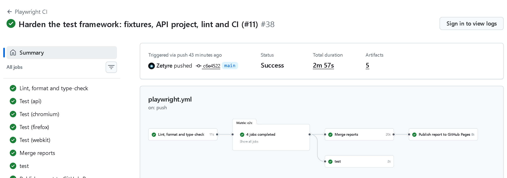
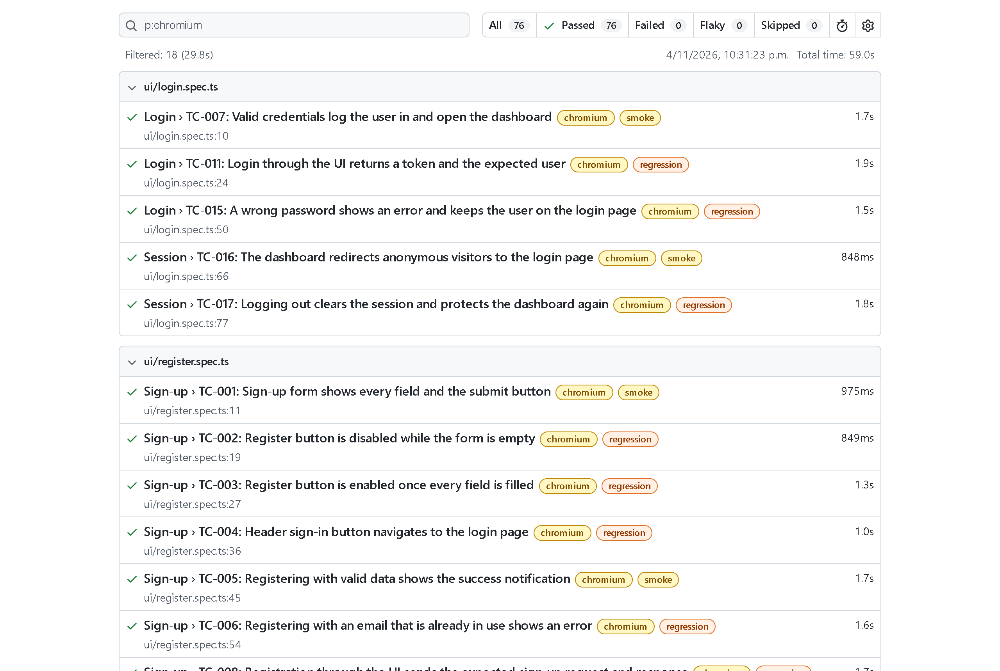
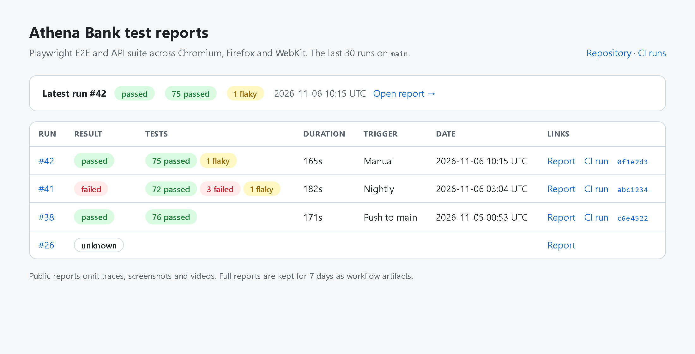
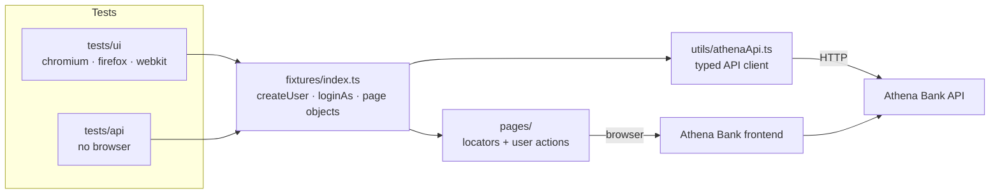
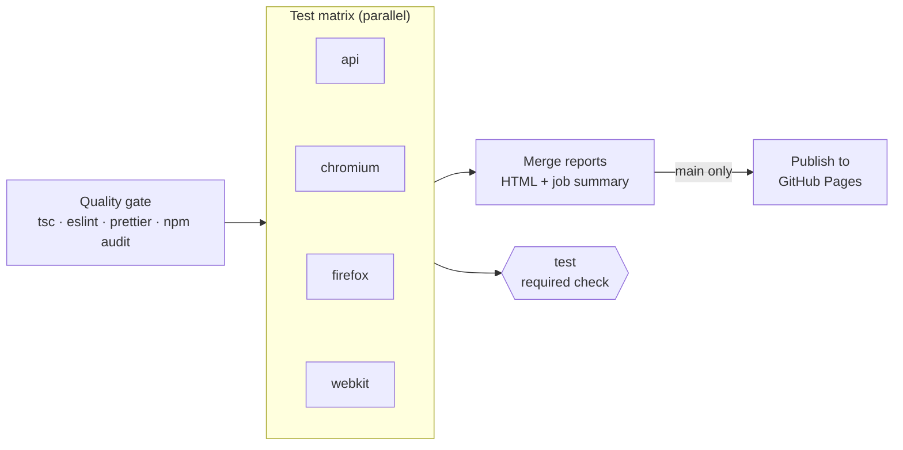

# Athena Bank: E2E & API test automation (Playwright + TypeScript)

[](https://github.com/Zetyre/athena-bank-playwright-tests/actions/workflows/playwright.yml)
[](https://zetyre.github.io/athena-bank-playwright-tests/)


[](LICENSE)

UI and API test automation for **Athena Bank**, a demo banking app built for practising test automation (React +
Vite frontend, Node/Express backend, MongoDB). The suite covers every feature of the app: sign-up, login, sessions,
accounts, deposits, freezing, closing accounts, transfers and the transaction history, at the API layer and
end-to-end in Chromium, Firefox and WebKit, plus WCAG 2.2 AA accessibility scans.

- **79 test cases, 97 tests** (56 API + 41 UI × 3 browsers = 179 runs, two to three minutes locally), tagged
  `@smoke` / `@regression`
- **Fully parallel, no retries locally:** every test creates its own users through the API
- **Found 13 bugs and 9 observations** in the app, each with steps to reproduce and annotated screenshots
  ([known issues](#known-issues))
- **Every test documented:** what it checks, where its expected result comes from and how it is built, in the
  [test case catalogue](docs/test-cases.md)
- **Every run on `main` is published:** [browse the report archive](https://zetyre.github.io/athena-bank-playwright-tests/)

## Why this project

This started as a Playwright workshop exercise, and I rebuilt it as the kind of framework I'd want a team to adopt:
a suite whose result you can trust.

- **No false failures.** Tests share no state, so a red run means a real problem, not two tests colliding.
- **No false passes.** Tests assert outcomes ("the balance is 900"), not "the page loaded", and lint rules block
  missing `await`s and fixed waits.
- **Testing that finds bugs.** Negative, boundary and concurrency tests at the API found money being created and
  lost, and a wrong password being accepted.
- **Honest about what is a bug.** The app has no specification, so a finding is a **bug** only when the app
  contradicts itself or basic correctness; when the expectation comes from a standard or common practice, it is an
  **observation**.
- **Lean on purpose.** A test is added when it can find a defect or protects a critical flow
  ([what is not tested, and why](#not-tested-on-purpose)).

## At a glance

| CI pipeline: quality gate, one job per browser, merged report, required `test` gate                                                   |
| ------------------------------------------------------------------------------------------------------------------------------------- |
|  |

| HTML report: every test tagged and traceable                                                                           | Report archive on GitHub Pages                                                                         |
| ---------------------------------------------------------------------------------------------------------------------- | ------------------------------------------------------------------------------------------------------ |
|  |  |

## Run it locally

**Prerequisites:** Node.js 22 (see `.nvmrc`), Git, and MongoDB 7, either installed locally or in Docker.

### 1. Start the app under test

The [Athena Bank app](https://github.com/Zetyre/redux-athena-bank) lives in its own repository. CI tests it at a
pinned commit, so use the same one:

```bash
git clone https://github.com/Zetyre/redux-athena-bank.git
cd redux-athena-bank
git checkout ecab87e1aee435fd090a8e05b281c89331e275d0
```

Start MongoDB, unless you already have one running:

```bash
docker run -d --name athena-mongo -p 27017:27017 mongo:7.0.3
```

Create `backend/.env`:

```env
MONGO_URI=mongodb://localhost:27017/athena_bank
JWT_SECRET=any-local-secret
PORT=6007
```

Then start the backend and the frontend, each in its own terminal:

```bash
npm ci --prefix backend && npm --prefix backend start      # API on http://localhost:6007
```

```bash
npm ci --prefix frontend && npm --prefix frontend run build
cd frontend && npx vite preview --port 3000 --strictPort  # UI on http://localhost:3000
```

This serves a production build, the same way CI does. The dev server (`npm run dev`) also works for a quick look,
but under the full parallel suite Windows can run out of socket buffers (`net::ERR_NO_BUFFER_SPACE`).

### 2. Install and run the tests

```bash
git clone https://github.com/Zetyre/athena-bank-playwright-tests.git
cd athena-bank-playwright-tests
npm ci
npx playwright install --with-deps
```

| Command                   | What it runs                                                    |
| ------------------------- | --------------------------------------------------------------- |
| `npm test`                | Everything: `api`, `chromium`, `firefox`, `webkit`              |
| `npm run test:smoke`      | Only tests tagged `@smoke`                                      |
| `npm run test:regression` | Only tests tagged `@regression`                                 |
| `npm run test:api`        | The API project, no browser                                     |
| `npm run test:chromium`   | API plus Chromium, the fastest full check                       |
| `npm run report`          | Opens the last HTML report                                      |
| `npm run check`           | Type-check, lint and format check, the same gate CI starts with |

No users need to exist beforehand: each test creates the users and accounts it needs, with throwaway data.

| Variable               | Default                 | Purpose                                                                     |
| ---------------------- | ----------------------- | --------------------------------------------------------------------------- |
| `PLAYWRIGHT_BASE_URL`  | `http://localhost:3000` | Frontend under test                                                         |
| `API_BASE_URL`         | `http://localhost:6007` | Backend API under test                                                      |
| `PLAYWRIGHT_TEST_SEED` | random per run          | Replays the random transfer amounts of a run (recorded in each test's info) |
| `CI`                   | unset                   | Set by CI: enables `forbidOnly`, one retry and the CI reporters             |

## Architecture

Tests only talk to fixtures. Fixtures build page objects, create data through the API client and log browsers in,
so no test repeats setup code or knows how the app stores its session.



```
.
├── fixtures/index.ts            # createUser, loginAs, page objects and the API client, one line per test
├── pages/                       # Page objects: locators and user actions, no business assertions
├── tests/
│   ├── api/                     # "api" project: contract and negative tests against the backend
│   └── ui/                      # chromium / firefox / webkit: end-to-end flows and accessibility
├── types/api.ts                 # Typed request/response models
├── utils/
│   ├── athenaApi.ts             # Thin API client returning raw responses
│   ├── accessibility.ts         # axe-core scan, run after animations settle
│   ├── knownIssue.ts            # knownIssue(): marks a test that documents an open bug or observation
│   ├── userFactory.ts           # Unique test users
│   ├── testRandom.ts            # Seeded random numbers
│   └── urls.ts                  # Frontend/API base URLs from the environment
├── reporters/known-issues.ts    # Lists open bugs and observations, apart from real passes
├── scripts/                     # CI job summary and the GitHub Pages report archive
├── docs/                        # Test case catalogue, issue screenshots, README images
└── .github/                     # CI workflow, Dependabot, PR template, CODEOWNERS
```

## What a test looks like

An end-to-end test reads as the business scenario. Users, accounts and sessions come from fixtures, and each step
asserts a visible outcome for both sides of the transfer:

```ts
test(
  'TC-014: A transfer made through the UI appears for both sender and receiver',
  { tag: '@smoke' },
  async ({ page, loginAs, createUser, randomAmount, sendMoneyModal, openDashboardInNewContext }) => {
    const sender = await createUser(); // fresh user with a funded account, created through the API
    const receiver = await createUser();
    const amount = randomAmount(1, 1000); // reproducible with PLAYWRIGHT_TEST_SEED
    const senderDashboard = await loginAs(sender);

    await test.step(`Send ${amount} to the receiver through the UI`, async () => {
      await senderDashboard.sendMoneyButton.click();
      await sendMoneyModal.send(receiver.email, amount);
      await expect(page.getByText(`Transferencia enviada a ${receiver.email}`)).toBeVisible();
    });

    await test.step('Verify the incoming transfer in the receiver dashboard', async () => {
      const receiverDashboard = await openDashboardInNewContext(receiver); // second user, second browser context
      const incoming = receiverDashboard.transaction(`Transferencia de ${sender.email}`);
      await expect(incoming).toHaveCount(1);
      await expect(receiverDashboard.transactionAmount(incoming)).toContainText(amount.toFixed(2));
    });
  },
);
```

API tests check the response and that nothing moves when a request is rejected:

```ts
test(
  'TC-030: A transfer larger than the balance is rejected and nothing moves',
  { tag: '@regression' },
  async ({ api, createUser }) => {
    const sender = await createUser({ initialBalance: 50 });
    const receiver = await createUser({ initialBalance: 0 });

    const response = await api.transfer(sender.token, {
      fromAccountId: sender.account!._id,
      toEmail: receiver.email,
      amount: 51,
    });

    await expectError(response, 400, 'Insufficient funds');
    expect(await balanceOf(api, sender)).toBe(50);
    expect(await balanceOf(api, receiver)).toBe(0);
  },
);
```

## Design decisions

**Test data is created through the API, per test.** `createUser` signs a user up and opens a funded account in a
few milliseconds. Nothing is shared between tests or browsers, so the suite runs fully parallel and any test can
run alone.

**Logging in skips the form.** Only the login tests use the login form. Everything else uses `loginAs(user)`,
which puts the user's token in the browser before the app starts. This is faster, and a login bug cannot fail
unrelated tests.

**API and UI are separate projects.** API tests don't start a browser. UI tests check what only the UI can show
(navigation, validation messages, what each user sees) and use the API for setup.

**Web-first assertions only.** No `networkidle` and no fixed waits; lint rules block both. `DashboardPage.goto()`
waits for the dashboard's own data requests, because the app loads accounts and transactions only once.

**Accessibility: automated where a tool can decide, by hand where it cannot.** axe-core scans every page and dialog
against WCAG 2.2 A and AA after animations finish. Keyboard access, the page language, titles and autofill hints
are checked directly. axe cannot judge text contrast over the app's animated background (it marks it "needs
review"), so the low-contrast texts were confirmed by hand and reported with screenshots (#4, #8).

**Known issues stay in the suite.** A test for an open bug asserts the correct behaviour and is marked
`test.fail()`, so the run stays green while the bug exists and fails as soon as the bug is fixed, as a reminder to
remove the marker. Playwright counts such a test as "passed", which would hide two things, so a small
[reporter](reporters/known-issues.ts) lists the open bugs and observations in the terminal and the CI summary, and
fails the run if a known-issue test fails with a different error than the one it declares (for example, a broken
selector instead of the bug).

**Retries are a signal, not a fix.** No retries locally and one on CI, so a flaky test is reported as "flaky"
instead of silently passing.

**Code quality is checked before any test runs.** TypeScript type-checking, ESLint (with
[`eslint-plugin-playwright`](https://github.com/playwright-community/eslint-plugin-playwright) and type-aware rules
that catch a missing `await`) and Prettier formatting run first, locally with `npm run check` and on CI.

## Test coverage

| Area            | UI                                                                                                                      | API                                                                                                                                                |
| --------------- | ----------------------------------------------------------------------------------------------------------------------- | -------------------------------------------------------------------------------------------------------------------------------------------------- |
| Sign-up         | Button enabling, success, duplicate email, request contract, server error shown                                         | Contract, duplicate email, missing fields, invalid data                                                                                            |
| Login & session | Login, wrong password, form validation, masked password, busy button, route guard, logout, rejected token, 320px layout | Contract, wrong password and unknown email, missing or oversized input, long passwords, non-string input, lockout, email case, token after logout  |
| Accounts        | Open an account, form validation, total balance, add funds, freeze and unfreeze, delete, history labels                 | All four types, invalid type, negative balance, deposits and their rules, amounts as text, cents, other users' accounts, malformed ids, history    |
| Transfers       | Transfer seen by both users, recipient without an account, balance check in the form, user data shown as text (no XSS)  | Exact debit and credit, insufficient funds, invalid amounts, unknown recipient, other users' accounts, frozen accounts, self-transfer, concurrency |
| Accessibility   | axe-core scans of three pages and two dialogs, keyboard-only login, keyboard access, page language and titles, autofill | (UI only)                                                                                                                                          |

Each test case, with its ID, is described in the [test case catalogue](docs/test-cases.md).

## Known issues

The app has no specification, so findings are classified by where the expected behaviour comes from:

- **Bug:** the app contradicts itself (its own form, message or code says otherwise) or basic correctness (money
  created or lost, a server error on normal input, data shown wrongly).
- **Observation:** the expectation comes only from a standard or common practice (WCAG, OWASP ASVS, banking
  practice). A design gap rather than a contradiction.

Each one has a `test.fail()` test unless noted, tagged `@bug` or `@observation`
(`npx playwright test --grep @observation`). Bugs are reported as issues on the app's repository with steps to
reproduce, expected and actual results, root cause and annotated screenshots. Observations are listed here; the
first four were reported as issues before this classification existed.

### Bugs

| #                                                           | Bug                                                                                                         | Why it is a bug                                                        | Test            | Screenshots                                                 |
| ----------------------------------------------------------- | ----------------------------------------------------------------------------------------------------------- | ---------------------------------------------------------------------- | --------------- | ----------------------------------------------------------- |
| [1](https://github.com/Zetyre/redux-athena-bank/issues/1)   | A transfer to your own account increases the balance: 1,000 becomes 1,100.                                  | A transfer never changes the total amount of money.                    | TC-036          | [view](docs/defects/01-self-transfer-after.png)             |
| [2](https://github.com/Zetyre/redux-athena-bank/issues/2)   | Five simultaneous transfers of the whole balance all succeed; only one updates the balances.                | The app's own "Insufficient funds" check must hold for every transfer. | TC-085          | [view](docs/defects/02-concurrent-sender.png)               |
| [3](https://github.com/Zetyre/redux-athena-bank/issues/3)   | The sign-up page's "¿Ya tienes cuenta? Iniciar sesión" line is never drawn, and widens the page past 320px. | It is in the page to be seen, like its counterpart on the login page.  | TC-043 (layout) | [view](docs/defects/03-signup-prompt-missing.png)           |
| [6](https://github.com/Zetyre/redux-athena-bank/issues/6)   | The page declares English (`lang="en"`) but the interface is Spanish.                                       | A leftover of the project template.                                    | TC-048          | [view](docs/defects/06-07-titles-and-lang.png)              |
| [7](https://github.com/Zetyre/redux-athena-bank/issues/7)   | Every page is titled "Vite + React + TS".                                                                   | A leftover of the project template.                                    | TC-049          | [view](docs/defects/06-07-titles-and-lang.png)              |
| [10](https://github.com/Zetyre/redux-athena-bank/issues/10) | A wrong password logs in if its first 72 characters match the real one.                                     | A wrong password must be rejected.                                     | TC-057          | [view](docs/defects/10-password-72-logged-in.png)           |
| [11](https://github.com/Zetyre/redux-athena-bank/issues/11) | Login with an array as email logs in; a number or object as password returns `500`.                         | Client input must never cause a server error.                          | TC-058          | [view](docs/defects/11-non-string-credentials.png)          |
| [12](https://github.com/Zetyre/redux-athena-bank/issues/12) | An amount sent as text is appended: `"100"` turns a balance of 1,000 into 1,000,100.                        | It creates money.                                                      | TC-068, TC-074  | [view](docs/defects/12-amount-as-text-receiver.png)         |
| [13](https://github.com/Zetyre/redux-athena-bank/issues/13) | The API opens an account with a negative balance.                                                           | The app's own form rejects negative amounts.                           | TC-065          | [view](docs/defects/13-negative-opening-balance.png)        |
| [14](https://github.com/Zetyre/redux-athena-bank/issues/14) | Fractions of a cent are accepted and balances drift (0.1 + 0.2 = 0.30000000000000004).                      | The history shows "+ 0.00" while the balance moves.                    | TC-069          | [view](docs/defects/14-fraction-of-cent-deposits.png)       |
| [15](https://github.com/Zetyre/redux-athena-bank/issues/15) | Every closed account is shown as "Cuenta de débito cerrada", whatever its type.                             | The backend records the right type; the dashboard contradicts it.      | TC-080          | [view](docs/defects/obs-4-15-delete-with-balance-after.png) |
| [16](https://github.com/Zetyre/redux-athena-bank/issues/16) | An expired or rejected session leaves the user on an empty $0.00 dashboard.                                 | With no session at all, the app sends the user to login.               | TC-083          | [view](docs/defects/16-rejected-token-dashboard.png)        |
| [17](https://github.com/Zetyre/redux-athena-bank/issues/17) | A malformed account id returns `500` with the internal database error.                                      | Client input must never cause a server error.                          | TC-072          | [view](docs/defects/17-malformed-id.png)                    |

### Observations

| #                                                         | Observation                                                                                           | Based on                         | Test   | Screenshots                                                |
| --------------------------------------------------------- | ----------------------------------------------------------------------------------------------------- | -------------------------------- | ------ | ---------------------------------------------------------- |
| [4](https://github.com/Zetyre/redux-athena-bank/issues/4) | Several texts are below the contrast minimum: gradient buttons, a focused label, card texts, history. | WCAG 1.4.3                       | Manual | [view](docs/defects/04-contrast-dashboard.png)             |
| [5](https://github.com/Zetyre/redux-athena-bank/issues/5) | "Agregar cuenta" cannot be reached or used with a keyboard.                                           | WCAG 2.1.1, 4.1.2                | TC-047 | [view](docs/defects/05-keyboard-tab-order.png)             |
| [8](https://github.com/Zetyre/redux-athena-bank/issues/8) | Success and info notifications are below the contrast minimum.                                        | WCAG 1.4.3                       | Manual | [view](docs/defects/08-toast-success.png)                  |
| [9](https://github.com/Zetyre/redux-athena-bank/issues/9) | Login and sign-up fields do not declare their purpose for autofill.                                   | WCAG 1.3.5                       | TC-051 | [view](docs/defects/09-autocomplete-signup.png)            |
| OBS-1                                                     | No protection against brute force: after 10 wrong passwords, the right one still logs in at once.     | OWASP ASVS V2.2.1                | TC-059 | [view](docs/defects/obs-1-no-lockout-then-login.png)       |
| OBS-2                                                     | Emails are case-sensitive: a capitalised copy of an email creates a second account.                   | Common practice                  | TC-060 | [view](docs/defects/obs-2-email-case-duplicate-signup.png) |
| OBS-3                                                     | Sign-up accepts `not-an-email` as an email and `1` as a password.                                     | Common practice, NIST SP 800-63B | TC-061 | [view](docs/defects/obs-3-signup-invalid-data-created.png) |
| OBS-4                                                     | An account holding money can be deleted with no warning, and the money is gone.                       | Banking practice                 | TC-071 | [view](docs/defects/obs-4-delete-with-balance-dialog.png)  |
| OBS-5                                                     | Logging out does not invalidate the token; it keeps working for 7 days.                               | OWASP ASVS V3.3.1                | TC-076 | [view](docs/defects/obs-5-token-after-logout.png)          |

## Not tested on purpose

| Not covered                                          | Why                                                                                                                                     |
| ---------------------------------------------------- | --------------------------------------------------------------------------------------------------------------------------------------- |
| Visual regression (`toHaveScreenshot`)               | The animated particle background would make screenshot baselines churn on every run, for little bug-finding value in a demo app.        |
| Automated contrast checks                            | axe cannot measure text over the animated background, and a custom pixel check is more machinery than a demo app justifies.             |
| Mobile devices                                       | The app has no mobile-specific behaviour; the 320px layout checks cover narrow screens.                                                 |
| Performance and load                                 | Timings from a demo app on a test database say nothing about production. The concurrency test (TC-085) covers the one load-related bug. |
| Every input combination of every form                | Each validation rule is tested once, at the layer that enforces it.                                                                     |
| Transfers always go to the recipient's first account | A product decision: the API has no way to choose the recipient account.                                                                 |

## CI pipeline

[`.github/workflows/playwright.yml`](.github/workflows/playwright.yml)

| Trigger                | What runs                                                           |
| ---------------------- | ------------------------------------------------------------------- |
| Pull request to `main` | Full suite on `api` and `chromium`, `@smoke` on `firefox`, `webkit` |
| Push to `main`         | Full suite on every project, then publishes the report              |
| Nightly (03:00 UTC)    | Full suite on every project, then publishes the report              |
| Manual                 | Full suite or `@smoke`, chosen when starting the run                |



1. **Quality gate:** type-check, lint, format check and `npm audit` run before any browser starts.
2. **Test matrix:** one job per project, in parallel, inside the official Playwright Docker image. Each job starts
   MongoDB, the backend and a production build of the frontend, with the app pinned to a specific commit.
3. **Report:** the jobs' reports are merged into one HTML report, and the job summary lists passed tests, open bugs
   and observations, failed and flaky tests. The full report, with traces, is kept for 7 days.
4. **Gate:** a single `test` job is the required status check for `main`, so branch protection never needs editing
   when the matrix changes.
5. **Publish:** on `main`, every run's report goes to the
   [GitHub Pages archive](https://zetyre.github.io/athena-bank-playwright-tests/). The last 30 are kept.

**Security.** Actions are pinned to commit SHAs, `GITHUB_TOKEN` is read-only except in the publish job, and the
public report copy leaves out traces and screenshots.

**Reading a failure:** open the run's **Summary**, download the `playwright-report` artifact, run
`npx playwright show-report <folder>`, and open the failed test's **Trace** to step through actions, network calls
and the page at each step.

## Known limitations

- The app hardcodes `http://localhost:6007` for login and sign-up and only allows CORS from port 3000, so the UI
  suite can only target an app served from `localhost:3000`. The API suite can target any environment through
  `API_BASE_URL`.
- Locally, workers are capped at 30% of CPU cores: above about six concurrent Firefox instances, Firefox crashes on
  Windows. CI runs one browser per job and is not affected.

## Tech stack

Playwright, TypeScript, axe-core (`@axe-core/playwright`), ESLint (`typescript-eslint`, `eslint-plugin-playwright`),
Prettier, GitHub Actions.

## Contributing and license

Changes go through pull requests (see the [PR checklist](.github/pull_request_template.md)) and are listed in the
[changelog](CHANGELOG.md). Released under the [MIT License](LICENSE).

## Author

**Cristian Marrero**, QA Engineer. [LinkedIn](https://www.linkedin.com/in/cristian-marrero)
